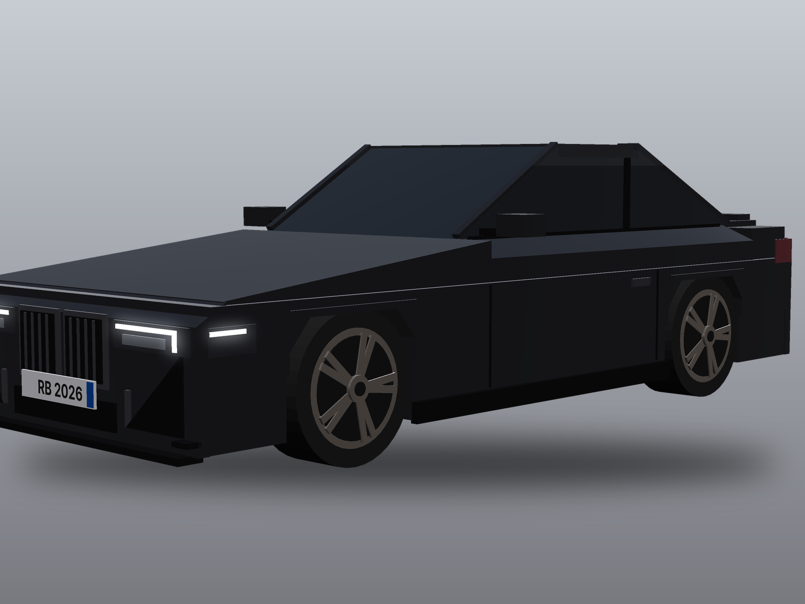
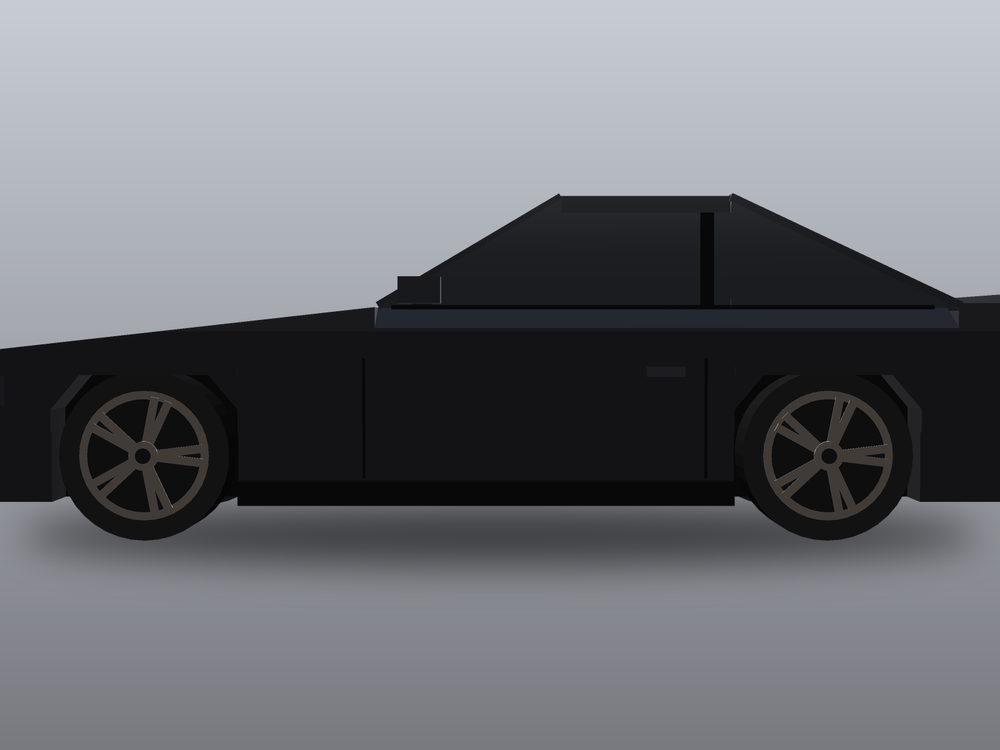
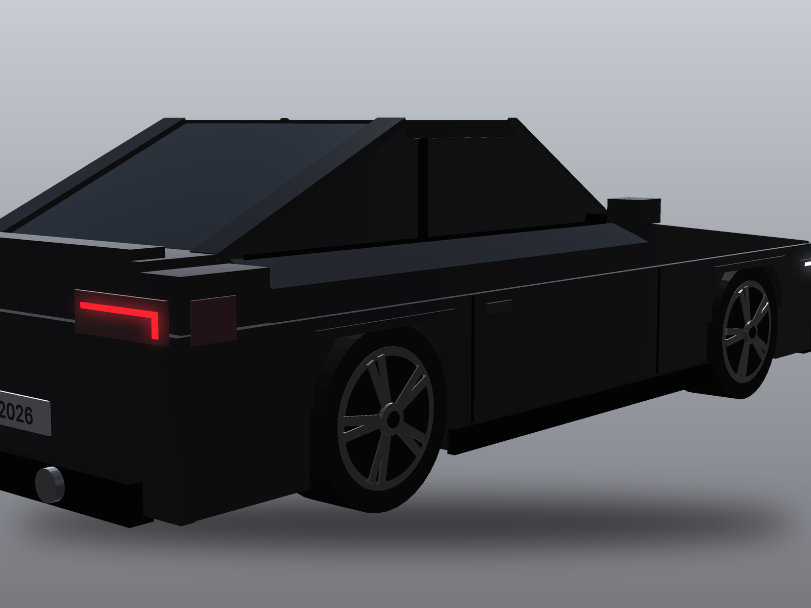

# Black Coupé – Roblox-Modell

Ein schwarzes Sport-Coupé im Roblox-Stil, nachgebaut nach einem Foto. Es besteht aus **182 Bauteilen** (Blöcke, Keile, Zylinder) und ist ohne Markenlogos und mit Fantasie-Kennzeichen „RB 2026“.

| Vorne | Seite | Hinten |
|---|---|---|
|  |  |  |

Icon-Vorschlag: `previews/icon_night_rush_512.png` (512×512, „NIGHT RUSH“ ist ein Platzhalter-Name).

## In Roblox Studio einfügen

1. Die Datei `BlackCoupe.rbxmx` herunterladen.
2. In Studio die Datei einfach ins 3D-Fenster ziehen. Alternativ: im Explorer Rechtsklick auf **Workspace** → **Insert from File…** → Datei wählen.
3. Das Auto erscheint als Model „BlackCoupe“. Alle Teile sind verankert (Anchored); es ist ein Ausstellungsmodell und fährt noch nicht.

**Bitte prüfen:** Das Modell wurde außerhalb von Studio erzeugt. Falls die schrägen Teile (Windschutzscheibe, Heckscheibe, Motorhaube) spiegelverkehrt aussehen, in `car.py` `WEDGE_HIGH_AT_PLUS_Z = False` setzen und neu bauen.

## Maße

Maßstab 1 Stud ≈ 0,28 m: 16,2 × 6,6 × 5,0 Studs (≈ 4,54 × 1,84 × 1,39 m), Radstand 9,8 Studs, Räder Ø 2,44 Studs.

## Ändern und neu bauen

```bash
python3 car.py                                   # Bauteile -> BlackCoupe.model.json
rojo build model.project.json -o BlackCoupe.rbxmx  # -> Roblox-Datei
python3 render.py vorschau.png front34 studio     # Vorschau (front34 | side | rear34 | top | icon)
python3 icon.py "SPIELNAME" icon.png              # Icon 512×512 im Neon-Stil
```

- Farbe: `PAINT` in `car.py` (z. B. `color=(150, 10, 20)` für Rot)
- Felgenfarbe: `RIM`
- Kennzeichen-Text: `PLATE_TEXT`

`render.py` ist ein kleiner eigener Renderer, der genau dieselben Bauteile zeichnet. Die Vorschaubilder entsprechen deshalb dem Modell, die Beleuchtung in Studio sieht aber anders aus.

## Nächste Schritte (Ideen)

- Fahrbar machen: VehicleSeat, Räder mit HingeConstraints, Federung mit SpringConstraints
- Offene Tür wie im Foto (Tür als eigenes Model mit Scharnier)
- Rundere Formen per Mesh (Blender oder Studio-KI-Generator), falls ein weniger kantiger Look gewünscht ist
