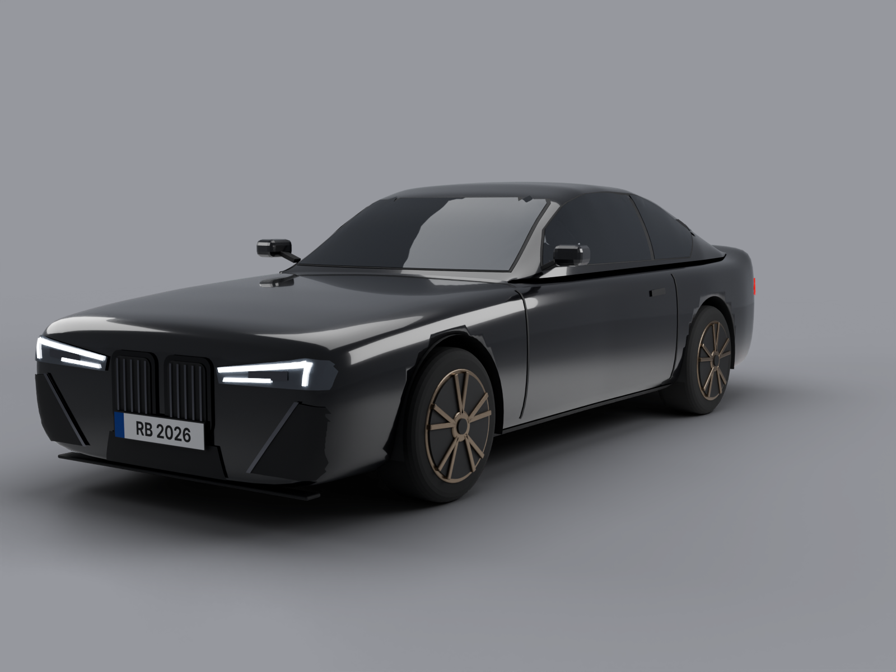
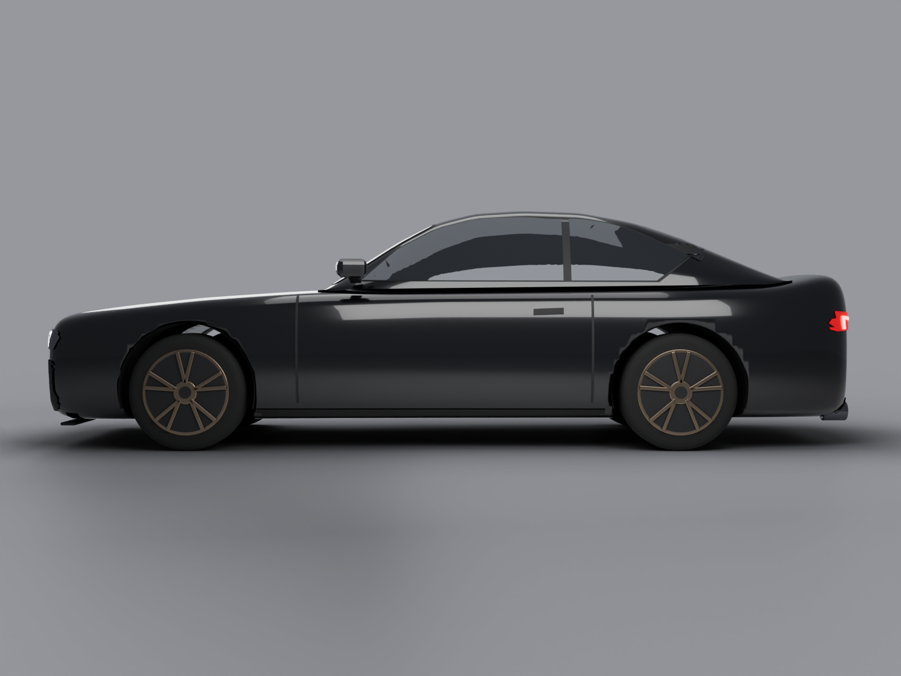
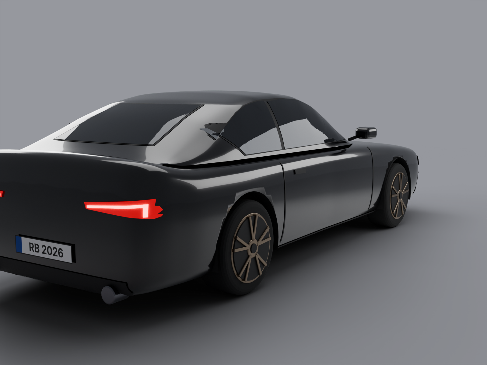

# Coupé HD – originalgetreues Roblox-Mesh-Modell (ohne Marke)

Nachbau eines schwarzen kompakten Sport-Coupés nach Foto, so nah am Original wie möglich, aber **ohne Logos und mit Fantasie-Kennzeichen**. Gebaut mit Blender (Python) als glatte Mesh-Karosserie statt Klötzen.

| Vorne | Seite | Hinten |
|---|---|---|
|  |  |  |

## Daten

- Maße: 16,2 × 6,6 × 4,95 Studs (≈ 4,54 × 1,84 × 1,39 m), Radstand 9,8 Studs, Reifen 245/35 R19.
- 29 MeshParts, alle unter Roblox' Grenze von 20.000 Dreiecken, zusammen ca. 93.000 Dreiecke.
- Räder sind eigene Teile (`WheelFL_…`, `WheelFR_…` …), damit das Auto später fahrbar gemacht werden kann.

## In Roblox Studio importieren

1. `coupe.glb` herunterladen.
2. Studio: **File → Import** → `coupe.glb` wählen.
3. In den Import-Einstellungen: **Scale Unit = Studs** (Standard), **Anchored** einschalten. „Import Only As Model“ eingeschaltet lassen.
4. **Import** klicken. Das Auto erscheint als Model.
5. Das Model im Explorer auswählen, dann **Script → Command Bar** öffnen, den Inhalt von `ApplyCarLook.luau` hineinkopieren und Enter drücken. Das setzt Lack, Glas, Neon-Lichter usw. auf Roblox-Materialien.

**Bitte prüfen:** Ich konnte den Import hier nicht in Studio testen. Größe, Ausrichtung (Front nach −Z) und Bodenhöhe habe ich in der GLB-Datei nachgemessen.

## Neu bauen / ändern

Voraussetzung: Python 3.13 mit `pip install bpy` (Blender 5.x als Modul) und Pillow.

```bash
python build_car.py --export coupe.glb                                   # Modell bauen + exportieren
python build_car.py --render out/ --views front34,side,rear34,photo        # Vorschau-Renders (Cycles)
python build_car.py --render out/ --env neon --views icon                  # Neon-Render fürs Icon
python icon.py out/hd_icon.png "NIGHT RUSH" icon.png                       # Icon 512×512
```

Wichtige Stellen in `build_car.py`:

| Was | Wo |
|---|---|
| Karosserieform | Keyframe-Listen `TOP_Y`, `MAX_HALF`, `DECK_HALF`, `ROOF_Y` … (Wert entlang der Länge `u`) |
| Lackfarbe | `material("Paint", …)` und in `ApplyCarLook.luau` |
| Felgenfarbe | `material("Rim", …)` |
| Kennzeichen | `PLATE_TEXT` |
| Scheinwerfer, Grill, Lufteinlässe | Funktion `details()` (Umrisse werden auf die Karosserie projiziert) |

## Bekannte Abweichungen vom Original

- Front-Details (Scheinwerfer-Innenleben, Lamellen in den Lufteinlässen) sind vereinfacht.
- Kein Innenraum, die Scheiben sind dunkel getönt.
- Die Doppelniere bleibt als Designmerkmal erkennbar. Für ein öffentliches Spiel ggf. neutraler gestalten.
